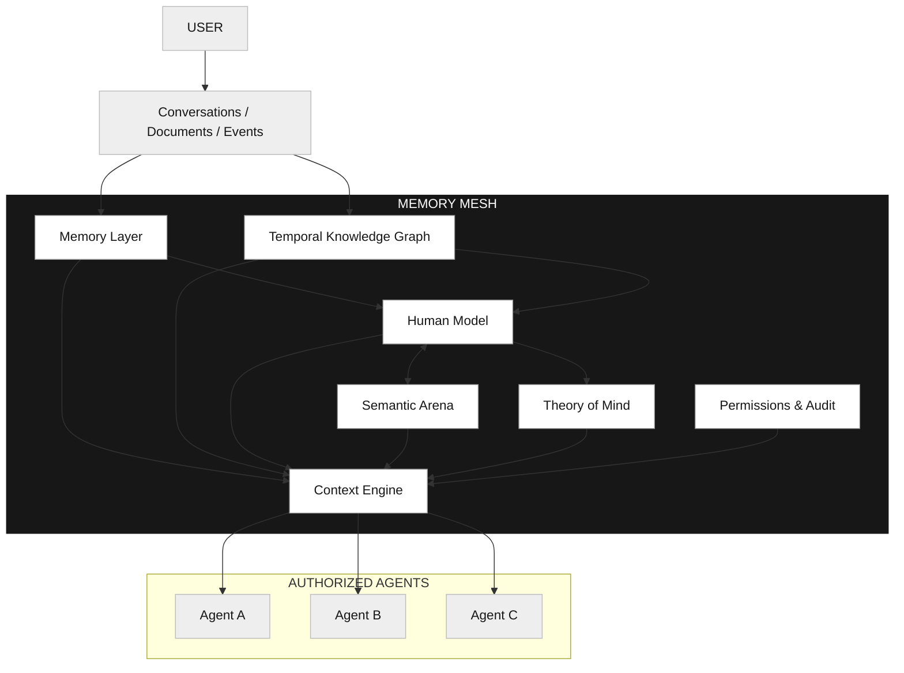
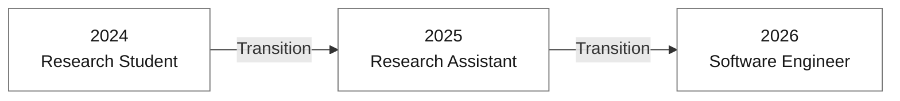
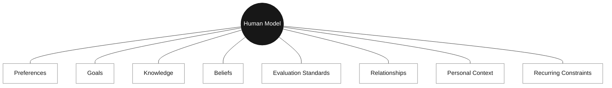
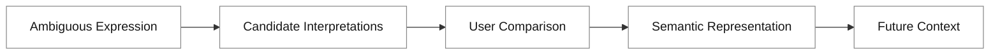
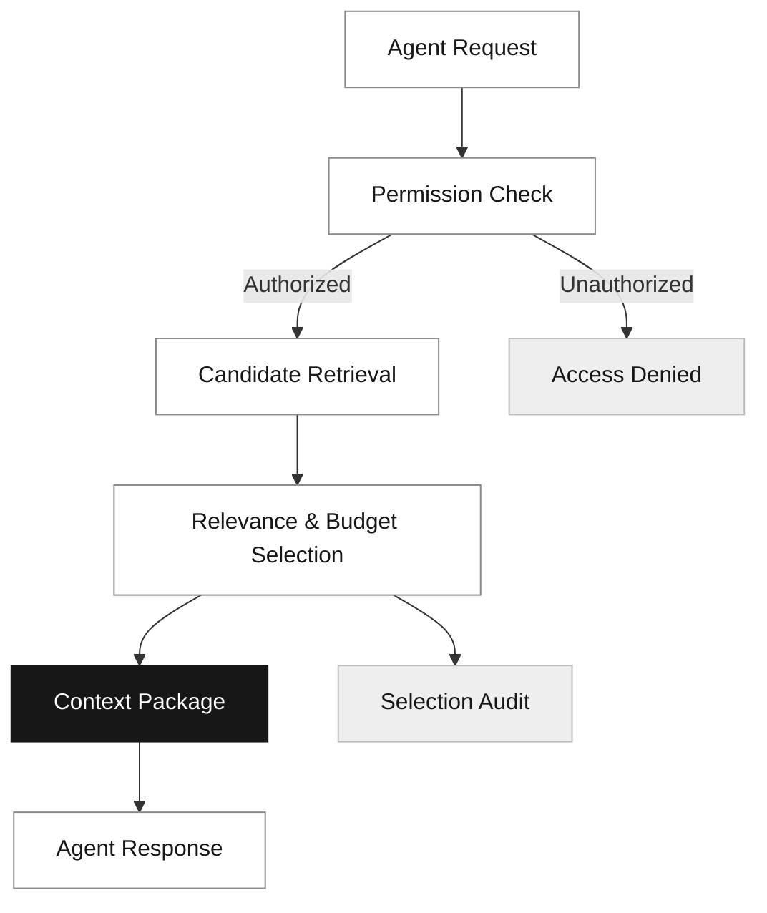

# Memory Mesh

**Open-source infrastructure for persistent memory and human modeling across AI agents.**

[](https://github.com/MengqiLi0000/memorymesh)
[](#integrations)
[](#integrations)
[](#integrations)
[](#implementation-status)

[**Overview**](#overview) &nbsp;·&nbsp;
[**Architecture**](#system-architecture) &nbsp;·&nbsp;
[**Research**](#research-directions) &nbsp;·&nbsp;
[**Quickstart**](#quickstart) &nbsp;·&nbsp;
[**Benchmarks**](#evaluation) &nbsp;·&nbsp;
[**GitHub ↗**](https://github.com/MengqiLi0000/memorymesh)

---


### Overview

AI assistants are increasingly capable of performing complex tasks, yet their understanding of individual users remains fragmented.

A person may spend months interacting with an assistant, explaining preferences, correcting misunderstandings, and establishing a shared vocabulary. When they switch to another application, much of this accumulated context is lost.

Existing memory systems address part of this problem through storage and retrieval. But remembering a statement is not necessarily the same as understanding its meaning.

Consider a user who repeatedly asks for writing to be "more sophisticated." A memory system might store this preference without determining whether the user means greater conceptual precision, more advanced vocabulary, or a different argumentative structure.

These distinctions are important for personalization. They are also difficult to capture through isolated memory records.

**Memory Mesh investigates how personal memory, semantic preferences, temporal relationships, and inferred user characteristics can be represented in a shared, inspectable system.**

The system is open source and designed to support multiple authorized AI agents.

---

## 01 / System architecture

Memory Mesh builds on two existing open-source systems:

- [Mem0 ↗](https://github.com/mem0ai/mem0) for memory storage and retrieval.
- [Graphiti ↗](https://github.com/getzep/graphiti) for temporally aware knowledge graphs.

The architecture introduces additional layers for human modeling, semantic learning, contextual retrieval, and cross-agent authorization.

### System architecture



*Figure 1. Memory Mesh organizes personal information into memory records, temporal relationships, and structured human representations. A permission-aware context engine selects information for requesting agents.*

The architecture separates information storage from user modeling and context delivery.

This distinction makes it possible to inspect where a representation originated, how it changed, and why it was retrieved for a particular task.

---

## 02 / Representing personal memory

Memory Mesh maintains personal information in multiple complementary representations.

### ◈ Memory

The memory layer stores statements, extracted facts, and other personal context. It supports creation, retrieval, updating, deletion, version history, import, export, and provenance tracking.

Information can be distinguished according to its origin. A statement explicitly made by a user is not equivalent to a conclusion inferred by an AI system.

This separation allows derived information to be corrected without changing the underlying historical record.

### ◈ Temporal Knowledge Graph

Personal information changes over time.

A user may change jobs, develop new interests, abandon earlier goals, or revise an existing preference. An ordinary record may capture the latest state without representing the sequence of changes that produced it.

The temporal graph represents relationships together with their temporal validity.



*Figure 2. Illustrative temporal representation. Historical states remain distinguishable from the currently valid state.*

This makes it possible to query what was believed to be true at a particular point in time, rather than only retrieving the latest record.

### ◈ Human Model

Memory Mesh maintains a structured model of the user across eight categories of personal information.

These include preferences, goals, knowledge, beliefs, evaluation criteria, relationships, and other recurring aspects of personal context.

Each modeled attribute can retain supporting evidence, confidence, confirmation status, and version history.

The human model is not treated as a definitive description of a person. It is a revisable representation based on available observations.



*Figure 3. Conceptual organization of the human model. The diagram summarizes eight information categories rather than a complete storage schema.*

---

## 03 / Learning personal meaning

One of the more difficult aspects of personalization is learning how a particular person interprets language.

Terms such as *professional*, *natural*, *concise*, and *sophisticated* do not have a single operational meaning.

Their interpretation depends on the user's background, preferences, and the context in which they are used.

### ◈ Semantic Arena

Semantic Arena attempts to make these interpretations explicit.

When the system encounters an ambiguous preference, it can present alternative interpretations and ask the user to select the one that best describes their intent.

For example:

**User request:** "Make this more professional."

| Interpretation | Possible meaning |
|---|---|
| A | Use more formal vocabulary |
| B | Increase factual and technical precision |
| C | Improve organization and argumentative clarity |
| D | Remove unnecessary emotional language |

The user's selection provides evidence about how the expression should be interpreted in future tasks.



*Figure 4. Semantic Arena uses explicit comparison feedback to refine user-specific interpretations of ambiguous expressions.*

The aim is to learn a reusable criterion rather than simply recording whether an individual response was accepted or rejected.

### ◈ Theory of Mind

Memory Mesh includes a Theory-of-Mind component for estimating what a user knows, what they may be trying to achieve, and how they might evaluate candidate responses.

These estimates are explicitly represented as hypotheses rather than established facts.

The offline implementation supports rule-based behavior. LLM-assisted inference and counterfactual reasoning remain subject to additional validation.

---

## 04 / Selecting context

A memory system may accumulate more information than can reasonably be supplied to an AI model during a single request.

Retrieval therefore involves more than finding semantically similar records.

The Context Engine selects information according to task relevance, available token budget, and access permissions.

It also records the rationale for including or excluding individual items.

### Context selection process



*Figure 5. The context engine enforces access policy before preparing a task-specific context package. Selection decisions are recorded for subsequent inspection.*

---

## 05 / Memory across agents

A shared memory infrastructure introduces a different access-control problem from that of an individual assistant.

Different applications may require different information about the same person.

A writing assistant may need information about tone and communication preferences. A financial agent may require access to financial records. Neither should automatically receive access to the other's complete context.

Memory Mesh supports scoped authorization, revocation, and access auditing.

### ◈ Access control

The system provides mechanisms for:

- Granting agent-specific access scopes.
- Revoking previously granted access.
- Rejecting unauthorized requests.
- Recording memory access in audit logs.
- Sharing approved context across applications.

### ◈ User inspection

Users can inspect, correct, export, and delete information maintained about them.

The system also distinguishes user-provided observations from derived interpretations, allowing a user to reject an inference without treating that inference as an established personal fact.

---

## 06 / External events

Personal context is not limited to chat messages.

Memory Mesh includes event ingestion interfaces for user-authorized information from other sources, including:

- Voice transcripts.
- Meeting records.
- Image descriptions.
- Device-generated events.
- Structured application events.

Event ingestion requires explicit user consent. The intended design does not support covert collection.

---

## 07 / Persona Vector Lab

**Experimental module**

Memory Mesh includes an optional research module investigating behavioral representations in locally hosted open language models.

This component is distinct from the human model.

The human model represents information about the user. Persona Vector Lab investigates behavioral characteristics of the AI model itself.

The experimental implementation explores extracting vectors associated with model traits, observing their activation, and applying interventions to influence model behavior.

This line of investigation is related to research on internal representations of model behavior, including:

[**Persona vectors: Monitoring and controlling character traits in language models ↗**](https://www.anthropic.com/research/persona-vectors)  
*Anthropic, 2025*

The Memory Mesh implementation is independent and should not be interpreted as a reproduction of all results reported in that research.

Current experiments are limited in scope and do not establish effectiveness across arbitrary models or production applications.

---

## 08 / Research directions

Memory Mesh brings together several problems that are often investigated separately.

### 1. Persistent user representations

How should a system distinguish stable personal characteristics from temporary instructions?

### 2. Temporal consistency

How should memories be revised when new evidence conflicts with older observations?

### 3. Semantic preference learning

Can explicit comparisons help an AI system learn what abstract preferences mean to an individual?

### 4. Cross-task transfer

When can information learned during one task improve performance on a different task?

### 5. Context allocation

How should limited context budgets be allocated across memories, inferred preferences, and task-specific evidence?

### 6. Controllable personalization

How can the benefits of persistent personal context be preserved while allowing users to inspect, correct, and revoke access to their information?

These remain open research questions. The implementation provides a framework in which they can be investigated.

---

## 09 / Integrations

Memory Mesh exposes five integration surfaces.

| Interface | Description |
|---|---|
| REST API | 49 endpoints |
| Python SDK | Programmatic Python access |
| TypeScript SDK | Integration with TypeScript applications |
| MCP Server | 8 tools for compatible AI clients |
| CLI | Service initialization and key management |

The MCP integration is intended for clients that support the Model Context Protocol.

For background on the protocol:

[Model Context Protocol ↗](https://modelcontextprotocol.io/)

### Web interface

The accompanying web application includes a landing page, interactive playground, module demonstrations, benchmarks, and documentation.

Its interactive module pages cover Memory, Temporal Graph, Human Model, and Semantic Arena.

The demonstration design allows visitors to use isolated environments without registering or supplying their own API keys.

The project also includes five starter templates, four of which have been tested successfully.

---

## 10 / Quickstart

### Clone

```bash
git clone https://github.com/MengqiLi0000/memorymesh.git
cd memorymesh
```

The repository includes API, SDK, MCP, and web application components.

Installation and startup commands depend on the selected component and its environment requirements.

The current repository should be consulted for the latest executable entry points before launching a service.

### Available development surfaces

**Python SDK**

Provides programmatic access for Python applications.

**TypeScript SDK**

Supports integration with JavaScript and TypeScript applications.

**MCP Server**

Exposes eight tools to compatible AI clients.

**REST API**

Provides 49 endpoints for direct service integration.

**CLI**

Supports service startup and administrative key management.

---

## 11 / Evaluation

The current evaluation covers three benchmark groups.

| Benchmark | Focus |
|---|---|
| Preference Learning | Learning user-specific semantic preferences |
| Memory Retrieval | Retrieving relevant stored information |
| Persona Vector Lab | Experimental model trait representations |

Benchmarks use synthetic data, and the reported results are generated by the implemented evaluation procedures.

### Test status

| Test suite | Result |
|---|---|
| Core tests | 13 passing |
| Persona Vector Lab | 5 passing |

These results establish correctness under the tested offline conditions. They do not by themselves establish production reliability, generalization across real users, or improvement over alternative memory architectures.

### Implementation status

**Validated offline**

Core memory functionality, temporal graph operations, human model representations, semantic learning, context selection, authorization mechanisms, and event handling have been tested without an external language model.

**Implemented but not fully validated**

Several language-model-dependent components are implemented but have not yet been exercised end to end:

- Mem0 automatic fact extraction.
- Graphiti automatic relationship extraction.
- LLM-assisted Theory-of-Mind hypotheses.
- Counterfactual reasoning.

**Remaining engineering work**

Docker images have not yet been built and validated. Additional agent functionality and homepage illustrations are still under development.

Some recent local changes have not yet been pushed to the public repository.

The distinction between implemented functionality and validated behavior is maintained throughout the project documentation.

---

## 12 / Project scope

Memory Mesh is currently a research prototype rather than a production-certified service.

The architecture provides components for memory persistence, human modeling, contextual retrieval, and permissioned sharing. Further evaluation is required to establish their effectiveness under realistic multi-agent workloads.

Important areas for continued investigation include:

- Retrieval performance at larger memory volumes.
- Reliability of model-generated inferences.
- Conflicting and outdated personal information.
- Permission enforcement across integrated applications.
- Privacy and security under adversarial conditions.
- End-to-end deployment behavior.
- Measurable benefits of cross-agent personalization.

The project is designed to make these questions observable and testable rather than assuming that storing more personal information necessarily produces better assistance.

---

## 13 / Related work

Memory Mesh builds on or draws motivation from several areas of research and engineering.

**Memory systems**

[Mem0 ↗](https://github.com/mem0ai/mem0)

**Temporal knowledge graphs**

[Graphiti ↗](https://github.com/getzep/graphiti)

**Model behavior and interpretability**

[Anthropic Transformer Circuits ↗](https://transformer-circuits.pub/)

[Persona Vectors ↗](https://www.anthropic.com/research/persona-vectors)

**Agent interoperability**

[Model Context Protocol ↗](https://modelcontextprotocol.io/)

These references provide technical context. They should not be interpreted as endorsements or claims of architectural equivalence.

---

## 14 / Contributing

Memory Mesh is an open-source project exploring persistent personal context and human modeling for AI systems.

Contributions are welcome in areas including:

- Memory and retrieval algorithms.
- Temporal graph representation.
- Semantic preference learning.
- Context selection and evaluation.
- Model interpretability.
- Agent interoperability.
- Privacy and access control.
- Documentation and developer tooling.

[**View source ↗**](https://github.com/MengqiLi0000/memorymesh)

[**Open an issue ↗**](https://github.com/MengqiLi0000/memorymesh/issues)

[**Pull requests ↗**](https://github.com/MengqiLi0000/memorymesh/pulls)

---

### Memory Mesh

*Open-source research and infrastructure for personal memory in AI systems.*

[GitHub ↗](https://github.com/MengqiLi0000/memorymesh) &nbsp;·&nbsp;
[Architecture](#system-architecture) &nbsp;·&nbsp;
[Research](#research-directions) &nbsp;·&nbsp;
[Evaluation](#evaluation)
